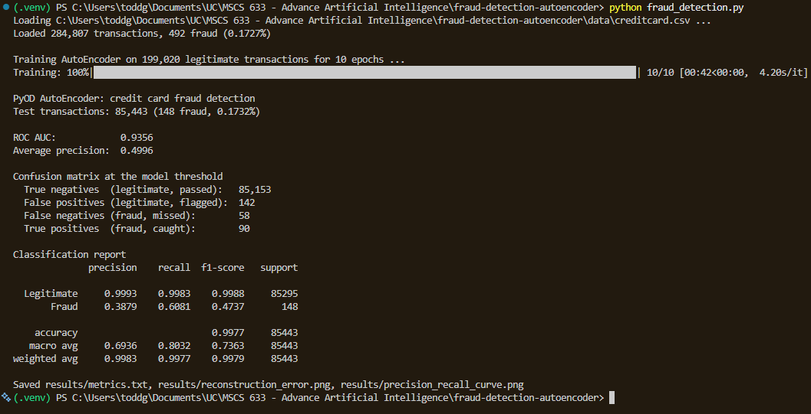

# Credit Card Fraud Detection with a PyOD AutoEncoder

Detects fraudulent credit card transactions with the [PyOD](https://github.com/yzhao062/pyod) AutoEncoder. The autoencoder is trained only on legitimate transactions, so it learns to rebuild normal spending patterns. Fraudulent transactions are rebuilt poorly, and that reconstruction error becomes the anomaly score.

## Dataset

[Kaggle: Fraud Detection](https://www.kaggle.com/datasets/whenamancodes/fraud-detection), file `creditcard.csv`. It holds 284,807 European card transactions, 492 of them fraud (0.17%). Features `V1` through `V28` are PCA-anonymized; `Time`, `Amount`, and the label `Class` are kept as is.

The file is about 150 MB, so it is not in this repository. Download it from Kaggle and place it at `data/creditcard.csv`.

## Requirements

- Python 3.11 to 3.13 (macOS 14 or newer on Apple Silicon)
- The packages in `requirements.txt`

## Setup and run

```bash
python3 -m venv .venv
source .venv/bin/activate          # Windows: .venv\Scripts\activate
pip install -r requirements.txt
python fraud_detection.py
```

Options: `--data path/to/creditcard.csv`, `--epochs 10`, `--batch-size 256`.

## How it works

1. **Load and prepare.** `Time` is dropped because it only records order. The data is split 70/30 with stratification so both sets keep the 0.17% fraud rate, and features are standardized with a scaler fit on the training set only.
2. **Train.** The autoencoder compresses 29 features through layers of 24, 12, and 6 units, then mirrors back to 29. It trains on the legitimate transactions in the training set only, so fraud never shapes what "normal" looks like.
3. **Score.** Each test transaction's reconstruction error is its anomaly score. The decision threshold flags the top 0.17% of errors, matching the training fraud rate.
4. **Evaluate.** ROC AUC and average precision measure how well scores rank fraud above legitimate transactions across all thresholds. The confusion matrix and classification report show results at the model's threshold. Accuracy is not a useful measure here: flagging nothing at all would already score 99.8%.

## Output

The script prints the metrics and saves them to `results/`:

| File | Contents |
| --- | --- |
| `metrics.txt` | ROC AUC, average precision, confusion matrix, classification report |
| `reconstruction_error.png` | Reconstruction error distribution, legitimate vs. fraud |
| `precision_recall_curve.png` | Precision and recall across every threshold |

## Screenshot


